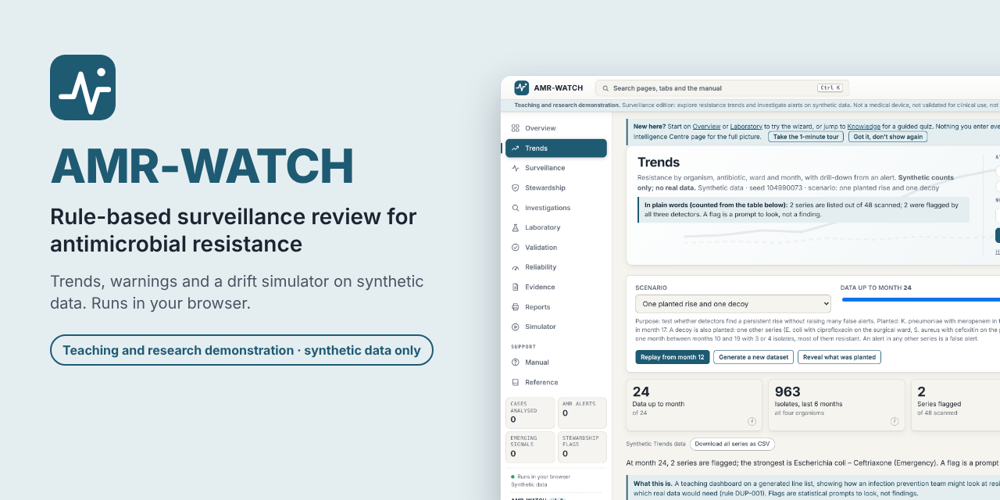
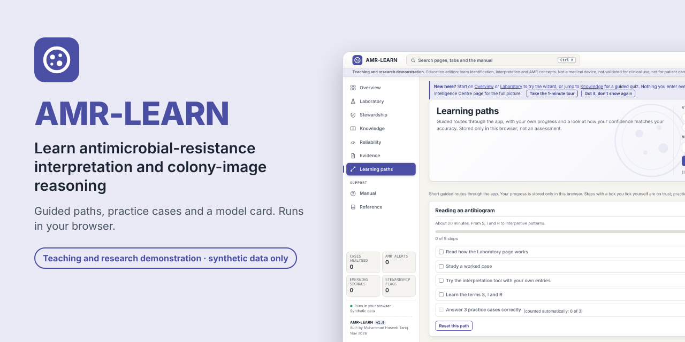
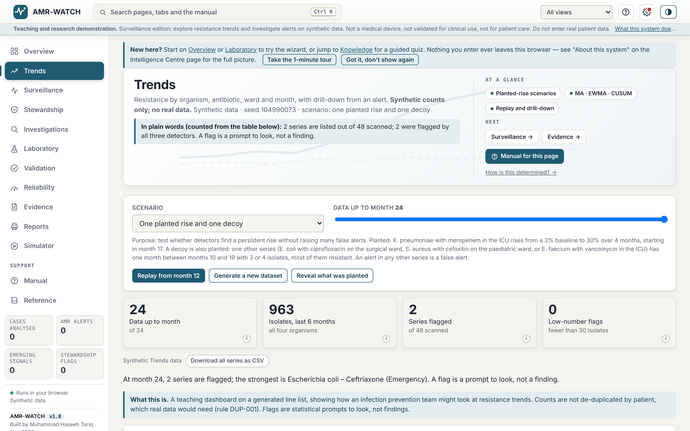
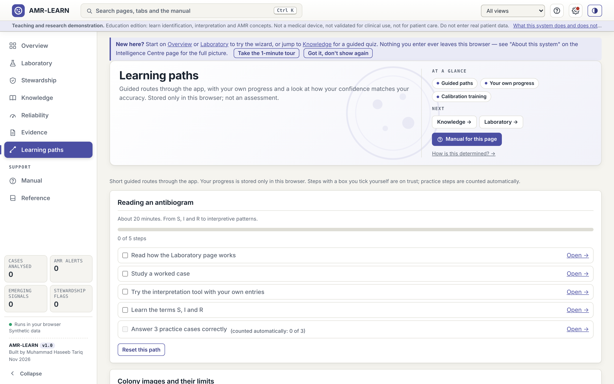

# AMR-LEARN and AMR-WATCH

Two single-file browser applications for teaching and research demonstration (version 1.0 interface):

- **AMR-WATCH**: rule-based review of antimicrobial-resistance trends and warnings on synthetic data (trends with Wilson intervals, moving-average, EWMA and CUSUM detectors, investigation worksheets, stewardship flags, a drift simulator and a rule playground).
- **AMR-LEARN**: learning AMR interpretation and colony-image reasoning (laboratory interpretation, practice cases with confidence tracking, learning paths, stewardship page, a research colony-image model with a model card).

> **Teaching and research demonstration. Synthetic data only. Not a medical device, not validated for clinical use, not for patient care or real surveillance reporting. Do not enter real patient data.**

## Open the applications online
- AMR-LEARN: https://muhammadhaseeb823.github.io/AMR-LEARN-WATCH/software/apps/AMR-LEARN-0.21.0.html
- AMR-WATCH: https://muhammadhaseeb823.github.io/AMR-LEARN-WATCH/software/apps/AMR-WATCH-0.23.0.html

The file names keep their original version numbers so that earlier links keep working. The version shown inside the applications is 1.0.

## Run them on your computer
Download the files in `software/apps/` into one folder and open the HTML file in a current browser. Nothing to install. AMR-LEARN also needs `amr_image_model.js` and `amr_image_model_crop.js` in the same folder.

## Privacy
Everything runs in your browser. Settings and progress are kept in browser local storage on your device. An optional explanation layer (Evidence page) is off unless you enter your own key; if you do, the text you send goes to that provider. There are no analytics or trackers.

## Verification
See `docs/VERIFICATION.md`. Detector, rule and model code is unchanged from the validated builds (AMR-LEARN 0.21.0, AMR-WATCH 0.23.0).

## Screenshots

More in `docs/images/` (dark and phone views; screen recordings `demo-watch.mp4` and `demo-learn.mp4`).

## Original release, scripts and results
The validated v1.0.0 files, the 183-file validation suite and the scripts and result files behind the two papers are in Zenodo release v1.0.0: https://doi.org/10.5281/zenodo.23926262 (all versions: https://doi.org/10.5281/zenodo.23926261).

## Licence and citation
MIT (see `LICENSE` and `LICENSES.md`). Cite using the "Cite this repository" button on GitHub (from `CITATION.cff`) or the Zenodo record above.
